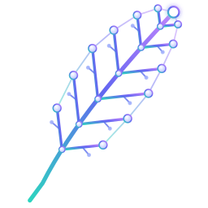
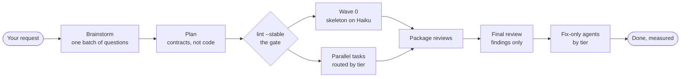

<p align="center">
  
</p>

<h1 align="center">superlite</h1>

<p align="center">
  <b>Hand an agent a spec. Come back to finished, tested work.</b><br>
  An autonomous, feather-light build workflow for Claude Code, held together by scripts and hooks instead of good intentions.
</p>

<p align="center">
  
  
  
  
</p>

---

## What it is

superlite plans a build, splits it into tasks that can run side by side, hands each task to the cheapest agent that can do it well, checks the seams, and reviews the result. You decide **who orchestrates**: you, or the AI.

- **Autonomous.** Describe the project, pick the AI orchestrator, and walk away. Decisions it has to make are recorded as rulings, not asked as questions.
- **Fast.** Up to 18 agents at once, a plan written for parallelism, and mechanical work on Haiku.
- **Gated by code.** The rules that matter are enforced by hooks and scripts that block the wrong move, not by a prompt that asks nicely.

### Not a rival to superpowers

superlite is **not a competitor** to [superpowers](https://github.com/obra/superpowers). superpowers is a careful, collaborative workflow that keeps a human close to every step, and it is excellent at that. superlite starts from its ideas (the plugin layout, the session-start hook, the lifecycle skills, with credit) and tunes them for a different job: **autonomous development, at speed**. If you want to steer each step, use superpowers. If you want to hand over a spec and come back to working code, use superlite. Pick one per session.

---

## It is fast

Same machine, same task: build a Python site generator and a spreadsheet engine from one spec (`sitegen` + `minisheet`, 177 hidden tests), headless on Opus.

| What we measured | superpowers | superlite |
|---|---|---|
| Wall-clock to a finished build | 33.6 min (stock, 3 runs: 21.2 / 31.9 / 47.6)<br>23.5 min (orchestrated, 3 runs) | **16.1 min** |
| Faster than superpowers | | **52%** vs stock, **31%** vs orchestrated |
| Fastest-to-slowest spread, 3 runs | 26.4 min | **9.1 min** |
| Agents working at once | 3 to 4 | **up to 18** |
| Hidden tests passed | 177 / 177 | 177 / 177 (a tie, at higher speed) |
| Earlier 9-module benchmark (1 run each) | 34.4 min, $8.15 | **8.8 min, $3.28** |
| superlite against its own first version | 26.9 min | **16.1 min** (40% faster) |

And it is not tied to one language. A TypeScript site generator went from spec to 132 / 132 hidden tests in **8.5 minutes for $3.39**.

<sub>The 16.1 min figure is one run of the current build. The superpowers figures, the spread row (3 runs of each, on an earlier superlite build) and the 9-module row (the first version, 1 run each) come from earlier runs on the same machine, so treat the gaps as indications, not a statistical proof. superlite spends more than orchestrated superpowers on this task ($9.38 against $6.89) and scores lower on the extra robustness probes (4 of 7 against about 5.7 of 7). Details, runs and caveats: [bench/](bench/) and the Benchmark section below.</sub>

---

## Gated by code, not by prompts

Instructions drift. Scripts and hooks do not. These gates run on every build:

| Gate | What it enforces | How |
|---|---|---|
| **The coordinator cannot write code** | Every change goes to a fix-only or implementer agent, by tier; the block message says which | `block-coordinator-edits` hook |
| **No unsafe kills** | No `pkill` or `taskkill /IM`; only PIDs the run started | `block-unsafe-kill` hook |
| **Tests never block the coordinator** | A raw `pytest`, `npm test`, `go test` and so on is rewritten into a background `sl run_tests` | `rewrite-test-runs` hook |
| **A plan must lint before work starts** | Stable tasks dispatch at once; others wait with a reason. Size band, frozen interfaces, and chain rulings that must carry the id lint printed | `lint --stable` |
| **Same plan, same agents** | Task features pick the agent tier from `routing.json`; Haiku only for mechanical tasks off the critical path, never for fixes | `routing.py` |
| **Agents stay in their tier** | A task goes only to an idle agent of its own tier; nothing queues behind a busy one | `dispatch` |
| **Cost caps are enforced** | Warns at 70% of the cap; over the cap it stops optional work | `sl budget` |
| **Every run is measured** | Each agent's tokens, cost and time are captured automatically and feed the next run's predictions | capture hooks, `~/.superlite/history.jsonl` |
| **No agent spawns agents** | Subagents get explicit tool lists with no `Agent` | agent definitions |

---

## Pick how to use it

| Situation | Say something like | What happens |
|---|---|---|
| **MVP, a new project** | "Build me a static site generator from this spec" | One batch of questions, a plan, then parallel tasks on Sonnet and Haiku, package reviews and one fresh final review |
| **A feature on existing code** | "Add CSV export with column widths to the existing app" | The same flow, with seam checks between the new and the existing code. On a large codebase it offers to install Graphify (never without your yes) |
| **Debug** | "This test fails on leap days: find the root cause and fix it" | `systematic-debugging` finds the cause first; fixes go to fix-only agents by tier, each leaving a note, and escalate after two failed rounds |
| **A small change** | "Rename `build` to `render` everywhere" | Small work stays inline, with a reviewer always |
| **Review and harden** | "Review this branch and fix what you find" | Package reviewers fix their own findings; the final reviewer reports findings with tiers and never edits |
| **Hands off** | "Build X. I am away, decide yourself" | The AI orchestrator plans, lints, dispatches and rules on open choices without stopping |
| **Ship it** | "We are done: finish the branch" | Verification first, then merge or PR options. It never pushes without you |

**Who orchestrates.** With a human orchestrator you validate the whole plan, shown with its predicted schedule, **before** it is linted and sent off. With the AI orchestrator it does everything itself.

---

## Install

You need Claude Code, git, Python 3.10 or newer (the tools are Python; the project you build can be in any language), and `bash` (Git Bash on Windows). `uv` is optional.

```
/plugin marketplace add iha2/superlite
/plugin install superlite@superlite-dev
```

Or load a local checkout for one session: `claude --plugin-dir <path-to-superlite>`

Open a fresh session and send `Let's make a react todo list`. A working install starts `brainstorming` before any code is written. Installs for Codex, Cursor, Gemini CLI, OpenCode and the other harnesses are in [Installation](#installation) below.

## Use it

1. **Describe what you want.** A paragraph or a spec file is enough.
2. **Choose the orchestrator** when asked: you validate the plan, or the AI does everything.
3. **Let it run.** Watch `.superlite/` in your project: `progress.md` has the rulings and the log, `test-summary.json` the latest test result, `metrics.jsonl` and the run history the time and cost per agent.



---

## Reference

The rest of this file is the reference: skills and agents, hooks, tools, config, per-harness installation, the benchmark harness and the task list.

## Skills

- `using-superlite` (injected at session start)
- `brainstorming`
- `writing-plans`
- `subagent-driven-development`
- `test-driven-development`
- `systematic-debugging`
- `verification-before-completion`
- `finishing-a-development-branch`

Agents (`agents/`):

- `implementer` (sonnet, medium): builds one task, then stays idle for reuse.
- `implementer-haiku` (haiku, high): builds one `Kind: mechanical` task (fully specified, small, fast tests) exactly as written; stops rather than guesses.
- `package-reviewer` (sonnet, medium): reviews one committed task or one package, then fixes its own findings with regression tests.
- `final-reviewer` (opus, high): a fresh one-turn reviewer that reads only the review packet (Read, Grep, Glob). It returns findings, each with a fix tier, and never fixes.
- `fixer-sonnet` (sonnet, medium): tier 1, cause known (including a fully specified change), fix confined to one module.
- `fixer-sonnet-high` (sonnet, high): tier 2, cause known but the fix spans modules or a seam, or a known probe class.
- `fixer-opus` (opus, high): tier 3, cause unknown (it diagnoses), or a lower tier failed twice.

### How a run works

The coordinator (Opus, medium effort) never writes project code or runs raw tests. `writing-plans` produces a task graph. A human approves the whole plan once, then `plan_tools lint --stable` freezes the stable tasks and the tier of each. In a delegated run (the user pre-approved or said "decide yourself") the plan is streamed: stable tasks start building while the fixes are made. Wave 0, the skeleton and stubs, is built first by `implementer-haiku` from a brief the tools write from the plan. Stable tasks are then dispatched by tier: Sonnet `implementer` by default, Haiku for `Kind: mechanical` tasks that are off the critical path (the mechanical lane). Consumers build against interface stubs and the `e.g.` contract examples, and integration is one task per package. `commit_task` commits each task's own files and starts probes and seam checks. Tests run in the background into `.superlite/test-summary.json`. `package-reviewer` reviews selected tasks or whole packages and fixes its own findings. A review packet (incidents, probe failures, test summary, source excerpts) goes to one fresh `final-reviewer`, which returns findings only, each with a fix tier. Fix-only agents (`fixer-sonnet`, `fixer-sonnet-high`, `fixer-opus`) take them by tier. A fix keeps a decision, so Haiku never fixes. Each round rewrites a file note in `.superlite/fixes/<id>.md`, and a tier that fails twice escalates to a fresh agent primed by the note. `finish` lists the rulings, and `history write` appends the run's rows to `~/.superlite/history.jsonl`. Design and decisions: `C:\Work\Planning\Specs\2026-10-17-superlite-architecture-design.md` (§3.0, §12).

### Hooks

`hooks/hooks.json` registers these. The run hooks are active only while a run marker exists (`.superlite/stable.json`, `prime.md` or `pool.json`, written by the first lint). They fail open on bad input.

- `session-start`: injects `using-superlite` at startup, clear and compact.
- `block-unsafe-kill`: always on for Bash and PowerShell; blocks killing processes by name or pattern (`taskkill /IM`, `pkill`, `killall`, `Stop-Process -Name`). Kill by PID is allowed.
- `block-coordinator-edits`: during a run, blocks the coordinator (calls without `agent_id`) from writing project code. It may write `docs/plans/**`, `SPEC*.md`, `docs/**/*.md` and `.superlite/**`. Subagents always pass.
- `rewrite-test-runs`: during a run, rewrites the coordinator's raw test commands (pytest, npm test, go test, cargo test, dotnet test, ...) into a background `sl run_tests --full`, and logs a `rule-rewrite` incident.
- `capture-agent-launch`: during a run, appends a `launch` record (agent id, type, model, description) to `.superlite/metrics.jsonl` after each `Agent` call.
- `capture-agent-stop`: during a run, appends a `stop` record (agent id, type, transcript path, last message) to `.superlite/metrics.jsonl` when a subagent stops.

### Tools

Mechanical steps are scripts, not agents. Every tool runs as `bash <skill-dir>/scripts/sl <tool> ...`, where `<skill-dir>` is `skills/subagent-driven-development`. The `sl` launcher runs a `.sh` tool under bash and a `.py` tool under the first working Python, and exits 3 when there is none. It caches that interpreter, so each later call is one Python start (`SUPERLITE_PYTHON` skips the probe entirely). Tools that need each other import them in process instead of spawning `sl` again. The tools are Python, but the project can be any language.

| Tool | What it does |
|---|---|
| `plan_tools` | Plan lint (`--stable` freezes tasks and tiers), task graph, stubs, schedule, prune, and the `adapter`, `packet` and `contract` review subcommands |
| `wave0` | Builds the Wave 0 skeleton brief for `implementer-haiku` from the plan alone |
| `routing` | Maps each task's plan features to a tier (haiku or sonnet) using `routing.json` |
| `shape` | Build shape: contract examples, removable edges, prune, chain ids |
| `predict` | Predicts each task's time, context and cost; `--refit` fits the coefficients |
| `build_prime` | Builds the shared prime that every agent reads first (`--tier haiku` builds the mini prime) |
| `dispatch` | Ready tasks and who runs each, in one call (`next_tasks` + `assign`) |
| `next_tasks` | Computes which tasks are ready |
| `assign` | Scores idle agents and picks the most relevant one |
| `commit_task` | Checks scope and commits one or more tasks' owned files; `--dispatch` also prints the next dispatch |
| `run_tests` | Runs the project's test command, with `--background`, then `--wait` for the summary; writes `.superlite/test-summary.json` |
| `testcmd` | Resolves the project's test command: `.superlite/test-cmd.json`, else detection (npm, go, cargo, dotnet, Python) |
| `pt_review` | `adapter`, `packet` (the final review packet) and `contract` (seam checks) |
| `probe_run` | Parallel robustness probes with no agents (Python projects only) |
| `incident` | Records and queries the shared incident log (file, line, context) |
| `budget` | One line of elapsed time and cost against the plan's target and cap |
| `metrics` | Per-task time, tokens and cost from `.superlite/metrics.jsonl` and agent transcripts |
| `history` | Run history: `write` rows to `~/.superlite/history.jsonl`, `read`, `derive` stats, `import` bench scores |
| `graphify_gate` | Gates Graphify for search in non-trivial codebases |
| `finish` | Collects the finish summary (rulings, commits, test counts, open incidents) |

`_pyrun.py` is a shared helper, not a tool. Probes live in `probes/` with the probe pack in `probes/pack/`.

### Config

In `skills/subagent-driven-development/config/`:

- `models.json`: prices (USD per million tokens) and output speed per model. Edit it when they change.
- `predictor.json`: the time and context coefficients and the size band `predict` uses. Refit with `sl predict --refit`.
- `routing.json`: task features to tier (`haiku` or `sonnet`), tier agents and limits, and the stats gate. A critical-path task never gets haiku.

### Language

The tools are Python, but the project can be in any language. `run_tests` uses the project's own test command (`.superlite/test-cmd.json`, else detection from its marker files). The probe stage (`probe_run`) is Python only.

## Configuration

- **`detail` (plan switch).** `writing-plans` records `**Detail:** contracts | tests | full` in the plan header, and a task can override it. `contracts` gives files, signatures and named tests with exact values. `tests` (the default) adds the test code verbatim and leaves the implementation to the implementer. `full` includes implementation code too, for tricky algorithms. `brainstorming` asks for it in its single batched question, and picks the default itself when unattended.
- **Final review.** The coordinator runs at medium effort. The final review is a fresh Opus `final-reviewer` at high effort: one turn, findings only, reading a review packet built from the logs, with a target under 30 s. It is not a fork, so `CLAUDE_CODE_FORK_SUBAGENT` is not needed.
- **Implementer cache TTL.** The implementer's frontmatter sets a 1-hour prompt cache TTL, so its history is still cached when fix rounds arrive waves later. Setting `CLAUDE_CODE_SUBAGENT_PROMPT_CACHE_TTL=1h` in the environment does the same.
- **Context-budgeted sizing.** Each task in a plan carries an `Est. context` line, predicted from the lines it writes, the lines it reads and the docs it is handed, on top of the implementer's fixed ~18k prefix. Tasks predicted above 80k are split, tasks whose variable part is smaller than the prefix are merged with a neighbor, no task is predicted to run longer than about 3 minutes, there is no fixed wave size (the task graph sets the parallel width), and the whole plan stays under 15k chars because it doubles as the shared prime. The coefficients are fit on one project, so treat them as a guide.

## Installation

Installation differs by harness. If you use more than one, install superlite separately for each one. Every integration loads `using-superlite` at session start; to verify, open a fresh session and send `Let's make a react todo list`. A working install triggers `brainstorming` before any code is written.

Each harness has a tool-mapping file in `skills/using-superlite/references/` (Antigravity, Codex, Gemini, Hermes, Muse, Pi, plus Claude Code notes). Where a harness has no plugin agents, each agent in `agents/` (`implementer`, `implementer-haiku`, `package-reviewer`, `final-reviewer` and the three fixers) runs as that harness's generic subagent with `agents/<name>.md` as its instructions.

### Claude Code

Load for one session from a local checkout:

    claude --plugin-dir <path-to-superlite>

Or add a local checkout as a marketplace:

    /plugin marketplace add <path-to-superlite>
    /plugin install superlite@superlite-dev

Or install from GitHub:

    /plugin marketplace add iha2/superlite
    /plugin install superlite@superlite-dev

### Antigravity

Install superlite as a plugin from this repository:

```bash
agy plugin install https://github.com/iha2/superlite
```

Antigravity runs the plugin's session-start hook, so superlite is active from the first message. Reinstall with the same command to update.

### Codex App

> Unverified: superpowers ships on Codex through the official Codex marketplace, which superlite isn't listed in. This repo includes `.agents/plugins/marketplace.json` for a repo marketplace, but the command below hasn't been tested yet.

- Add this repository as a plugin marketplace:

  ```bash
  codex plugin marketplace add iha2/superlite
  ```

- In the Codex app, click on Plugins in the sidebar, find `Superlite` in the Coding section, and click the `+` next to it.
- Add `[features]` `multi_agent = true` to `~/.codex/config.toml` for subagent dispatch.

### Codex CLI

> Unverified: superpowers ships on Codex through the official Codex marketplace, which superlite isn't listed in. This repo includes `.agents/plugins/marketplace.json` for a repo marketplace, but the command below hasn't been tested yet.

- Add this repository as a plugin marketplace:

  ```bash
  codex plugin marketplace add iha2/superlite
  ```

- Open the plugin search interface:

  ```bash
  /plugins
  ```

- Search for `superlite` and select `Install Plugin`.

### Cursor

- In Cursor Agent chat, install from marketplace:

  ```text
  /add-plugin superlite
  ```

- Or search for "superlite" in the plugin marketplace.
- Or load a local checkout of `https://github.com/iha2/superlite` as a local plugin; Cursor reads `.cursor-plugin/plugin.json`.

### Devin CLI

- Install the plugin from this repository:

  ```bash
  devin plugins install iha2/superlite
  ```

- Update to the latest version with:

  ```bash
  devin plugins update superlite
  ```

### Factory Droid

- Register the marketplace:

  ```bash
  droid plugin marketplace add https://github.com/iha2/superlite
  ```

- Install the plugin:

  ```bash
  droid plugin install superlite@superlite-dev
  ```

### Gemini CLI

- Install the extension:

  ```bash
  gemini extensions install https://github.com/iha2/superlite
  ```

- Update later:

  ```bash
  gemini extensions update superlite
  ```

### GitHub Copilot CLI

- Register the marketplace:

  ```bash
  copilot plugin marketplace add iha2/superlite
  ```

- Install the plugin:

  ```bash
  copilot plugin install superlite@superlite-dev
  ```

### Grok Build CLI

> Unverified: superpowers ships on Grok through the official xAI marketplace, which superlite isn't listed in. The commands below haven't been tested yet.

- Register this repository as a marketplace:

  ```bash
  grok plugin marketplace add iha2/superlite
  ```

- Install the plugin:

  ```bash
  grok plugin install superlite@superlite-dev --trust
  ```

- Or open the marketplace in the TUI, search for Superlite, and install it:

  ```text
  /marketplace
  ```

### Kimi Code

- Open Kimi Code's plugin manager:

  ```text
  /plugins
  ```

- Install directly from this repository:

  ```text
  /plugins install https://github.com/iha2/superlite
  ```

- Start a fresh session with `/new` afterwards.
- Detailed docs: [docs/README.kimi.md](docs/README.kimi.md)

### OpenCode

OpenCode uses its own plugin install; install superlite separately even if you already use it in another harness.

- Tell OpenCode:

  ```
  Fetch and follow instructions from https://raw.githubusercontent.com/iha2/superlite/refs/heads/main/.opencode/INSTALL.md
  ```

- Detailed docs: [docs/README.opencode.md](docs/README.opencode.md)

### Pi

Install superlite as a Pi package from this repository:

```bash
pi install git:github.com/iha2/superlite
```

For local development, run Pi with a checkout loaded as a temporary package:

```bash
pi -e /path/to/superlite
```

The Pi package loads the superlite skills and a small extension that injects the `using-superlite` bootstrap at session startup and again after compaction. Subagent and task-list tools remain optional Pi companion packages.

### Qwen Code

Qwen Code installs plugins from Claude Code marketplaces directly.

- Install the plugin from this repository:

  ```bash
  qwen extensions install iha2/superlite
  ```

- Update later:

  ```bash
  qwen extensions update superlite
  ```

### Hermes Agent

Install superlite as a Hermes plugin from this repository:

```bash
hermes plugins install iha2/superlite --enable
```

Restart any active Hermes sessions after installing. Hermes has no post-compaction hook, so a very long session that compacts over its first turn loses the bootstrap; start a fresh session if skills stop triggering.

### Muse

Superlite is a native Muse plugin. The `using-superlite` bootstrap is injected via the native `SessionStart` hook, with no per-session opt-in.

- Install from a local checkout:

  ```bash
  muse plugins install ./
  muse plugins approve superlite
  ```

  Or clone and install:

  ```bash
  git clone https://github.com/iha2/superlite.git
  muse plugins install ./superlite
  muse plugins approve superlite
  ```

- Update later:

  ```bash
  muse plugins update superlite
  ```

Restart any active Muse sessions after installing so the `SessionStart` hook takes effect; hooks require approval on first install.

### Keeping versions in sync

The version lives in every manifest listed in `.version-bump.json`. Bump all of them with one command, and check for drift with `--check` or `--audit`:

```bash
scripts/bump-version.sh 0.2.0
scripts/bump-version.sh --check
```

## Benchmark

`bench/` holds a head-to-head harness: both plugins build the same 9-module project (`bench/task/SPEC.md`) headless on Opus, and a hidden 89-test suite scores the result. Run 1 (n=1 per arm; the runs overlapped):

| | superpowers 6.4.1 | superlite 0.1.0 |
|---|---|---|
| Wall-clock | 34.4 min | **8.8 min** (3.9× faster) |
| Hidden tests | 89 / 89 | 89 / 89 |
| Cost (API-equivalent) | $8.15 | **$3.28** (60% cheaper) |

Full write-up: [bench/report.md](bench/report.md). (An earlier version of these numbers overstated both costs because of a scoring bug; see the correction note in the report.)

### Running it

From the repo root. `harness.py` runs one arm headless and scores it against the hidden suite; `BENCH_TASK` picks a task from `bench/tasks/` (`combo`, `combo-planted`, `brownfield`, `ts-wordstat`, `ts-textkit`, `ts-logflow`, `ts-logflow-plus`, `ts-sitegen`).

    uv run --no-project python bench/harness.py run <arm> <rep> [--smoke]
    uv run --no-project python bench/harness.py score <arm> <rep>
    uv run --no-project python bench/harness.py rescore-tasks <arm> <rep>
    uv run --no-project python bench/harness.py report

Arms are `superpowers` and `superlite`. Environment variables: `SUPERLITE_PLUGIN_DIR` points the superlite arm at another plugin directory (for example a worktree of an older commit, as a frozen baseline); `BENCH_PROMPT_SUFFIX` appends text to the task prompt.

Analysis scripts:

    python bench/report_mechanical.py bench/results/combo-superlite-x1.mechanical.json bench/results/*.json
    python bench/report_mechanical.py --history ~/.superlite/history.jsonl [--focus opus,haiku] [--baseline sonnet]
    python bench/mechanical_ab.py RUN_DIR [--tasks T8,T5] [--n 3] [--cost-cap 2.0] [--timeout 300] [--dry-run] [--wait]
    python bench/routing_evidence.py [--write]
    python bench/build_shape_audit.py [--runs DIR] [--write]
    python bench/predict_calibration.py [--write]

`report_mechanical` compares tasks by agent and model. `mechanical_ab` replays `Kind: mechanical` tasks on Haiku and on the Sonnet implementer. `routing_evidence` gives per-band outcomes by model and a routing recommendation. `build_shape_audit` shows what each task graph costs and which edges could go. `predict_calibration` shows why predicted times miss and fits a model on real runs.

## Tasks

- [ ] **Superlite 0.3: a task-graph flow that aims at half of superpowers' time.** The design is in `C:\Work\Planning\Specs\2026-10-17-superlite-architecture-design.md` (D10-D18, G1, R1). Steps:
  - Smoke-test the 0.3 tools and agents.
  - Combined task (`bench/tasks/combo`), 3 reps, arms in parallel.
  - E12: planted defects (`bench/tasks/combo-planted`), 3 reps with and without the incident log.
  - E13: brownfield (`bench/tasks/brownfield`), 3 reps with and without Graphify.

  Done when the superlite median is at most 0.5x superpowers' on the combined task (G1) at equal hidden-test score and robustness of at least 6/7, and the E12 and E13 effects are measured.

## Note

Do not enable superlite at the same time as superpowers. They share skill names and both inject session context, so they conflict.

## License

MIT
