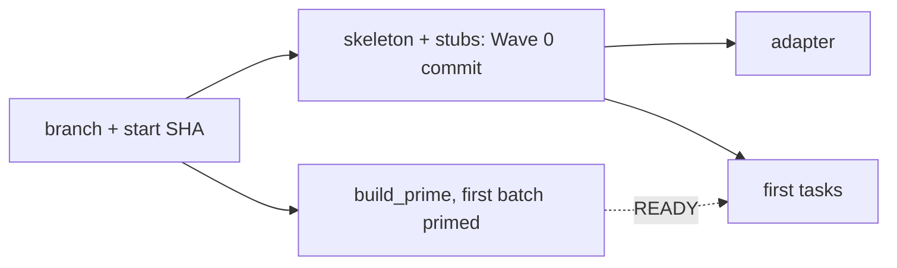
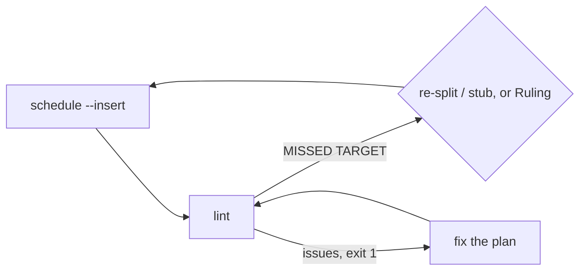
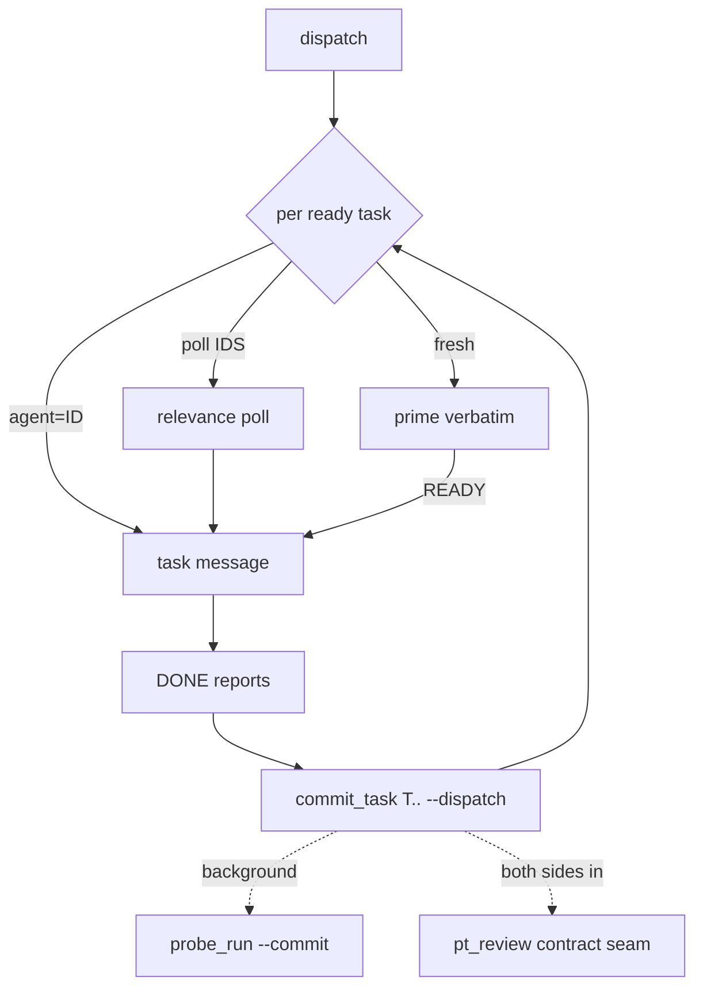
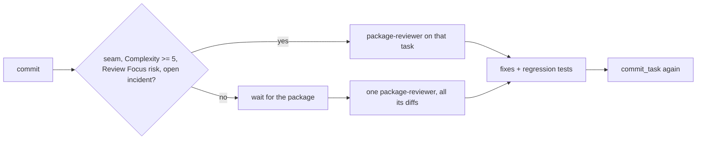
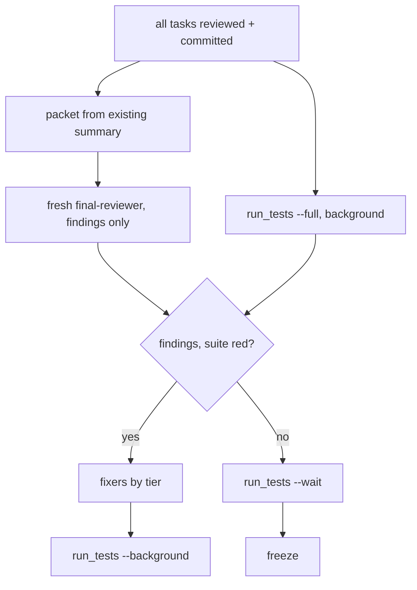

# Subagent-Driven Development

You are the coordinator. You decide, dispatch and rule; scripts do everything with a definite answer; agents design, write, review and fix. Read each script's one-line output, never raw logs. One line of narration between tool calls. Never paste skill text into a brief.

Shorthand used below (every agent brief states `SUPERLITE=<path>`):
`SUPERLITE` = the plugin root, two levels above this skill's "Base directory for this skill: ..." path: `SUPERLITE="$(cd "<base dir>/../.." && pwd)"`, passing the base dir through `cygpath -u` first when that exists. `SL="$SUPERLITE/skills/subagent-driven-development/scripts/sl"`; always run it as `bash "$SL" ...`. `PLAN` = the plan file; pass `--plan $PLAN` everywhere. Tool exit 3 means no Python: log it with `bash "$SL" incident add` and continue.

**You never edit code or run raw `pytest`; fixes go to fixer agents: tiers, escalation and contract in `fixing.md` (Fixing). Never pass `model`; never use `general-purpose` or ad-hoc reviewers.**

**Rulings, not stalls.** Decide conflicts and plan defects yourself (spec binds, plan argues). Append `Ruling: <decision> - <why> - <cost if wrong>` to `.superlite/progress.md`; `finish` collects them.

## Setup

- Branch `superlite/<topic>` if on the default branch (no worktree, no prompt). Write the start SHA to `.superlite/progress.md` (`- start <sha>`). `commit_task` adds `.superlite/` to `.git/info/exclude` itself.
- Wave 0, yourself, one commit of exact paths (never stage everything): project manifest, package inits, test config, shared error types, plus `bash "$SL" plan_tools stubs --plan $PLAN`. Stubs are contracts: nobody changes a signature without your ruling. Then `bash "$SL" plan_tools adapter --plan $PLAN` (writes `.superlite/probes/adapter.py` from the `Probe entry` lines).
- Prime during Wave 0: `bash "$SL" build_prime --plan $PLAN --spec SPEC --sections "1,3"` prints `hash size` and writes `.superlite/prime.md`. Record the hash. Start the first ready tasks' agents now (see the loop); their tasks go out once Wave 0 is committed. Never retype the prime (a changed byte breaks the cache).
- Incident log: `.superlite/incidents.jsonl` (append-only; agents call `bash "$SL" incident add`). You log BLOCKED and NEEDS_CONTEXT with `--agent coordinator`.
- Graphify: `bash "$SL" graphify_gate` prints JSON. `use` false: skip. Installed: `graphify update .`. `needs_install` and `allowed` (approved at the gate, or `SUPERLITE_ALLOW_INSTALL=graphify`): `uv tool install graphifyy`, then `graphify extract . --code-only`. Otherwise skip. You alone run `graphify update .` after each package commits.

## Planning check

One coordinator for the whole plan; each approved section only adds its tasks to its queue (drafts are skipped). The moment a section lints clean, run `dispatch` and start its ready tasks in that same turn; never wait for the next section. Per approved section: run `bash "$SL" plan_tools schedule --plan $PLAN --insert` (target from the plan header), then `bash "$SL" plan_tools lint --plan $PLAN --spec SPEC`. Lint exit 1 lists real defects (placeholders, Consumes without Produces, oversize tasks): fix and rerun. `MISSED TARGET: ... critical path T1 -> T5` is a warning, exit 0. Split or stub the named tasks and rerun `schedule --insert`, or accept it with `Ruling: accept predicted <N> min - <why sequential> - <cost>`.

## The scheduling loop

Keep `.superlite/pool.json`: `{"agents":[{"id","tasks":[...],"files":[...],"context_k":N,"idle_min":N,"busy":false,"current":"Tn"}]}`. Sending a task or spawning its agent sets `busy: true` and `current: Tn`; `commit_task` clears `current` when it commits Tn. The ledger and `current` are the state: you keep no lists.

1. `bash "$SL" dispatch --plan $PLAN --cap 10` prints, per ready task, longest first: `Tn agent=ID`, `Tn poll ID,ID` or `Tn fresh`; no agent is on two lines. Start them all now.
2. Per line: `agent=ID`: SendMessage the task to that idle agent. `poll ID,ID`: one SendMessage to each listed agent, "Relevance 0-10 for Tn (files, consumes)? Reply `score: N - reason`"; use the replies present at your next turn, highest wins, tie to the smallest `context_k`. `fresh`: Agent `superlite:implementer` (`superlite:implementer-haiku` if `Kind: mechanical`, never for design) with the prime file pasted verbatim, same bytes for the whole run, and send its task only after its reply `READY`. `evict=ID` (stderr): drop it from the pool. `dispatch` never offers a busy agent, or one past 3 tasks, 80k context or 50 idle minutes; work never queues behind an agent.
3. Task message: heading (not the task text; the plan is in the prime), Owns and files not to touch, the Review Focus categories for its files, rulings and interface names, `SUPERLITE=<path>`, the verify command (`bash "$SL" run_tests --fast PATHS --background`, then `--wait`), and "reply in at most 200 words: status DONE / DONE_WITH_CONCERNS / NEEDS_CONTEXT / BLOCKED, files, test result, open questions".
4. Handle every pending report in one turn. Mark reporters `busy: false`, then commit all DONE tasks in one call: `bash "$SL" commit_task T3 T5 --plan $PLAN --dispatch` commits each task's own files, prints `Tn <sha>` or `Tn FAILED` (one task: just the SHA), then `next:` and dispatch lines. A FAILED task lists unowned files or syntax/import problems: send them back to the agent. DONE_WITH_CONCERNS: fix correctness concerns before review. NEEDS_CONTEXT: answer. BLOCKED: log it, hand the task to a fixer one tier up (Fixing). Act on the `next:` lines.
5. After a commit, `commit_task` has already started `probe_run --commit` and, for each seam whose two sides are now both committed, `pt_review contract --seam` in the background. A pass logs `verified`; a mismatch is an incident. Route the fix per `fixing.md`.
6. Probe failures: `bash "$SL" incident hotspots --files <task files>` before assigning the next work. Open failures go to fixers (`fixing.md`); `commit_task` accepts generated `tests/regression/` files from whichever task commits.

## Reviews (D16)

- Matching tasks get `superlite:package-reviewer` the moment they commit, in the same message as the next dispatches. Others get one review per package once its tasks have committed. Once a package is the last one building, review each of its tasks as it commits, so only the final task's review trails the build.
- Brief: `SUPERLITE=<path>`, commit or range, spec slice, `PLAN`, files in scope, `bash "$SL" incident hotspots --files ...` output, adapter path. It reviews, fixes with regression tests, logs, never commits; its files are off limits meanwhile.
- On its report, commit the fixes with `commit_task Tn` per reviewed task ("nothing to commit" means it found nothing). Read only `Status:` and open items.
- No review re-runs on its own fixes.

## Coordinator batching

- One message per turn: all dispatches, reviews, background starts.
- Split anything predicted over 3 min.
- Every test run is `run_tests ... --background`; read the summary, never wait, except the one `--wait` before the final commit. No foreground suites, none after the merge.

## Final review

1. Gate: every task committed, every review reported and committed, every seam `verified`.
2. Build the packet now: `bash "$SL" plan_tools packet --plan $PLAN --base <start-sha>` uses the existing `.superlite/test-summary.json`, the probe results and the incidents, and writes `.superlite/review-packet.md`. Its header says `FAST PATH` or `REVIEW REQUIRED` and whether the test summary is from the full suite or the last fast run. In the same message start `bash "$SL" run_tests --full --background`; do not wait for it before the packet or the reviewer.
3. Start `superlite:final-reviewer` at the same moment, fresh, brief = `SUPERLITE=<path>` and "read .superlite/review-packet.md", nothing more. The tree stays frozen. It answers in one turn, reading only the packet, findings only: `Verdict: APPROVED` or `CHANGES_REQUESTED` plus `file:line - problem - fix - tier N` lines.
4. Red suite lines are findings too. Send all findings to fixers (`fixing.md`: tier by understanding, split by file), then `commit_task Tn` per owning task and one more `run_tests --background`. Leftovers become a `Ruling:` in the closing message. No second review round.
5. Right before the final commit, `bash "$SL" run_tests --wait` once; green means freeze.

## Freeze, rulings, finish

After a green suite: no polish, refactors or new probes. Archive `.superlite/incidents.jsonl` and `progress.md` next to the plan; commit them by name. Run `bash "$SL" finish`; print its rulings in your closing message under "Rulings I made", each with what it costs if wrong. Then invoke `superlite:finishing-a-development-branch`.

## Stop conditions

Stop and ask only for: an irreversible or destructive operation; a security-sensitive action; an outward side effect (merge, push, publish); a plan so broken every path is a guess. All else is a ruling.

**Unattended** (user away, "decide yourself", or pre-approved): never end your turn to wait. For those four cases take the safe path: defer the outward or destructive action, read a broken plan conservatively, record the ruling, keep going. List what you deferred in the closing message.

## Red flags

| Thought or act | Do instead |
|---|---|
| Typing the prime or a fresh agent's task before READY | `build_prime`, paste verbatim, wait for READY |
| Sending work to a busy agent, or "after T3" | `dispatch` |
| Committing by hand or staging everything | `commit_task T3 T5 --dispatch` |
| Editing code, raw `pytest`, or a foreground suite | Fixer agent; `run_tests --background` |
| Reviewing every task | Selective per task, else per package |
| Final reviewer browsing or probing | Packet only; probes ran earlier |
| Killing by image name | By PID only (a hook blocks the rest) |
| Polish after green | Freeze |
| Asking "should I continue?" | Only the four stop conditions |
