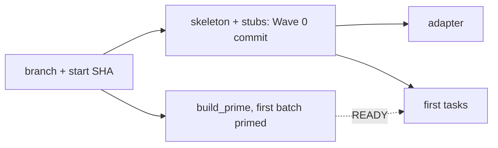
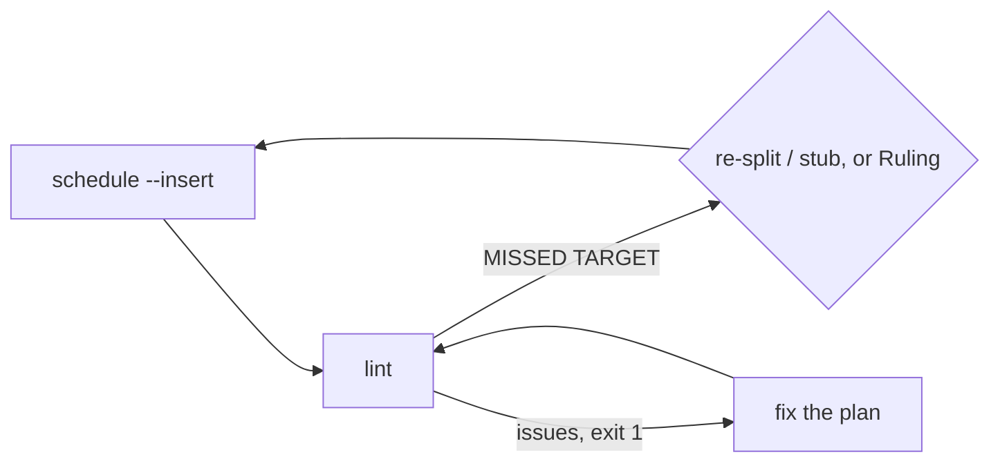
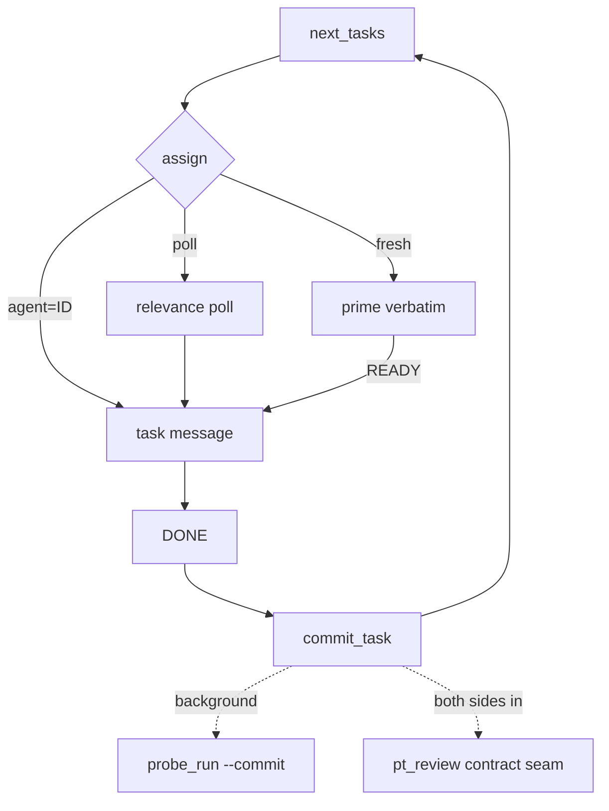
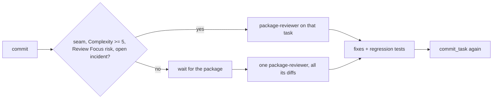
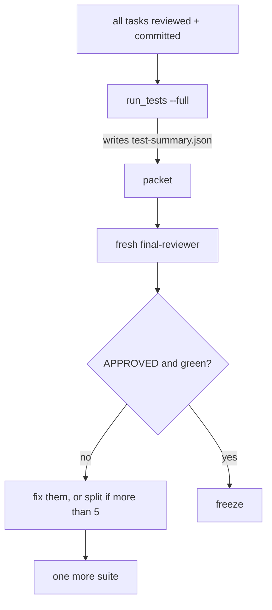

# Subagent-Driven Development

You are the coordinator. You decide, dispatch and rule; scripts do everything with a definite answer; agents design, write, review and fix. Read each script's one-line output, never raw logs. Keep narration to one line between tool calls. Do not change your own effort. Agents carry their rules: never paste skill text into a brief.

Shorthand used below (every agent brief states `SUPERLITE=<path>`):
`SUPERLITE` = the plugin root (`$CLAUDE_PLUGIN_ROOT`). `SL="bash $SUPERLITE/skills/subagent-driven-development/scripts/sl"`. `PLAN` = the plan file; pass `--plan $PLAN` everywhere. Tool exit 3 means no Python: log the gap with `$SL incident add` and continue without it.

**Rulings, not stalls.** Decide conflicts and plan defects yourself (the spec binds, the plan argues, your judgment fills the rest). Append `Ruling: <decision> - <why> - <cost if wrong>` to `.superlite/progress.md`; `finish` collects them.

## Setup

- Branch `superlite/<topic>` if on the default branch (checkout -b; no worktree, no prompt). Write the start SHA to `.superlite/progress.md` (`- start <sha>`). `commit_task` adds `.superlite/` to `.git/info/exclude` itself.
- Wave 0, yourself, one commit of exact paths (never stage everything): project manifest, package inits, test config, shared error types, plus `$SL plan_tools stubs --plan $PLAN`. Stubs are contracts: nobody changes a signature without your ruling. Then `$SL plan_tools adapter --plan $PLAN` (writes `.superlite/probes/adapter.py` from the `Probe entry` lines).
- Prime during Wave 0: `$SL build_prime --plan $PLAN --spec SPEC --sections "1,3"` prints `hash size` and writes `.superlite/prime.md`. Record the hash. Start the first ready tasks' agents now (see the loop); their tasks go out once Wave 0 is committed. Never retype the prime; a changed byte breaks the shared cache.
- Incident log: `.superlite/incidents.jsonl` (append-only; agents call `$SL incident add`, so there is nothing to copy). You log BLOCKED and NEEDS_CONTEXT with `--agent coordinator`.
- Graphify: `$SL graphify_gate` prints JSON. `use` false: skip. Installed: `graphify update .`. `needs_install` and `allowed` (approved at the gate, or `SUPERLITE_ALLOW_INSTALL=graphify`): `uv tool install graphifyy`, then `graphify extract . --code-only`. Otherwise skip; never install silently. You alone run `graphify update .` after each package commits.

## Planning check

Run `$SL plan_tools schedule --plan $PLAN --insert` (the target comes from the plan header), then `$SL plan_tools lint --plan $PLAN --spec SPEC`. Lint exit 1 lists real defects (placeholders, Consumes without Produces, oversize or over-3-min tasks): fix and rerun. `MISSED TARGET: ... critical path T1 -> T5` is a warning, exit 0. Consider splitting or stubbing the named tasks, then rerun `schedule --insert`; or accept it with `Ruling: accept predicted <N> min - <why sequential> - <cost>`. Show the warning and ruling at the approval gate. `taskgraph` warnings (`mergeable`) are handled by ruling.

## The scheduling loop

Keep a `committed` and a `running` list and `.superlite/pool.json`: `{"agents":[{"id","tasks":[...],"files":[...],"context_k":N,"idle_min":N,"busy":false}]}`.

1. `$SL next_tasks --plan $PLAN --committed T1,T2 --running T3 --cap 10` prints ready ids, longest first. Start all of them now; the rest start the moment any slot frees.
2. Per id: `$SL assign --task Tn --pool .superlite/pool.json --plan $PLAN` prints one word. `agent=ID`: SendMessage the task to that idle agent. `poll`: one SendMessage to every eligible idle agent, "Relevance 0-10 for Tn (files, consumes)? Reply `score: N - reason`"; use the replies present at your next turn, highest wins, tie to the smallest `context_k`. `fresh`: Agent `superlite:implementer` with the prime file pasted verbatim, same bytes for the whole run, and send its task only after its reply `READY`. Fan fresh agents out in one message. `evict=ID` lines on stderr: drop that agent from the pool. Busy agents are never candidates, work never queues behind an agent, and an agent past 3 tasks, 80k context or 50 idle minutes is not resumed.
3. Task message: heading (not the task text; the plan is in the prime), Owns and files not to touch, the Review Focus categories for its files, rulings and interface names, `SUPERLITE=<path>`, the verify command (`$SL run_tests --fast PATHS`), and "reply in at most 200 words: status DONE / DONE_WITH_CONCERNS / NEEDS_CONTEXT / BLOCKED, files, test result, open questions".
4. Handle every pending report in one turn. DONE: `$SL commit_task Tn --plan $PLAN` prints the SHA and appends the ledger; exit 1 lists out-of-scope, syntax or import problems, so send them back to the agent. DONE_WITH_CONCERNS: fix correctness concerns before review. NEEDS_CONTEXT: answer. BLOCKED: log it, re-dispatch once on a fresh agent with `model: opus`, then take the task over yourself. Update `pool.json`, rerun `next_tasks`. Do not poll; wait once.
5. After a commit, `commit_task` has already started `probe_run --commit` and, for each seam whose two sides are now both committed, `pt_review contract --seam` in the background. A pass logs `verified`; a mismatch is an incident (nothing to run yourself). Assign the fix to the idle owner of one side, or to a `superlite:package-reviewer`.
6. Probe failures: `$SL incident hotspots --files <task files>` before assigning the next work. Open failures on a file go to the idle agent that owns it, with the fix and a regression test; `commit_task` accepts the generated `tests/regression/` files from whichever task commits.

## Reviews (D16)

- Matching tasks get `superlite:package-reviewer` the moment they commit; dispatch it in the same message as the next dispatches. All others wait and get one review per package, once the package's remaining tasks have committed.
- Brief: `SUPERLITE=<path>`, commit or range, spec slice, `PLAN`, files in scope, the output of `$SL incident hotspots --files ...`, and the adapter path. It reviews, fixes with regression tests, logs, and never commits. Its files are off limits to others meanwhile.
- On its report, commit the fixes with `commit_task Tn` per reviewed task ("nothing to commit" means it found nothing). Read only the `Status:` line and open items; findings are in the log.
- A review is never re-run on its own fixes; the final suite and final review cover them.

## Coordinator batching

- One message per turn: all dispatches, a commit's reviews, background starts.
- One turn for all pending reports; never one turn per report.
- Longest predicted first; cap 10 concurrent; split anything predicted over 3 min.
- Slow suites run once via `run_tests` after commit, never in an implementer's loop.

## Final review

1. Gate: every task committed, every review reported and committed, every seam `verified`.
2. `$SL run_tests --full` first and wait for it to finish: it writes `.superlite/test-summary.json`. Only then `$SL plan_tools packet --plan $PLAN --base <start-sha>` (reads that and `.superlite/probes/probe-results.json`) writes `.superlite/review-packet.md`, so the packet carries this run's results; its header says `FAST PATH` or `REVIEW REQUIRED`.
3. Agent `superlite:final-reviewer`, fresh, brief = `SUPERLITE=<path>` and "read .superlite/review-packet.md", nothing more; never start it before the packet is built from a finished suite. The tree is frozen throughout. It answers in one turn, no tools: `Verdict: APPROVED` (a few seconds on the fast path) or `CHANGES_REQUESTED` plus `file:line - problem - fix` lines.
4. Red suite lines in the packet are findings. APPROVED and green: freeze. Otherwise reply "fix them" to the same reviewer (up to 5 findings; it adds a regression test per fix and reruns the covering tests). More than 5: split them by file across fresh `superlite:package-reviewer` agents in parallel. Then `commit_task Tn` per owning task, run one more `run_tests --full`, and stop; leftovers become a `Ruling:` and go in the closing message. No second review round.

## Freeze, rulings, finish

After a green suite: no polish, no refactors, no new probes. Archive `.superlite/incidents.jsonl` and `.superlite/progress.md` next to the plan and commit those paths by name. Run `$SL finish`; print its rulings in your closing message under "Rulings I made", each with what it costs if wrong. Then invoke `superlite:finishing-a-development-branch`.

## Stop conditions

Stop and ask only for: an irreversible or destructive operation; a security-sensitive action; an outward side effect (merge, push, publish); a plan so broken that every path is a guess. Everything else is a ruling.

**Unattended** (the user is away, said "decide yourself", or pre-approved): never end your turn to wait. For those four cases take the safe path: defer the outward or destructive action, read a broken plan conservatively, record the ruling, keep going. The closing message lists what you deferred.

## Red flags

| Thought or act | Do instead |
|---|---|
| Typing the prime or a fresh agent's task before READY | `build_prime`, paste verbatim, wait for READY |
| Sending work to a busy agent, or "after T3" | `assign`; `fresh` when none is eligible |
| Committing by hand or staging everything | `commit_task Tn` |
| Running the suite yourself, or through an agent | `run_tests`; read its one line |
| Reviewing every task | Selective per task, else per package |
| Final reviewer browsing or probing | Packet only; probes ran earlier |
| Killing by image name | By PID only (a hook blocks the rest) |
| Fix rounds, polish after green | One fix pass, one suite, freeze |
| Asking "should I continue?" | Only the four stop conditions |
