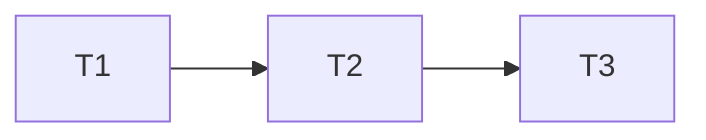

# minisheet plan

**Probe entry:** call=minisheet.evaluator.evaluate · serve=minisheet.server.create_server(Workbook())

### T1 engine · Complexity 3
**Owns:** src/minisheet/evaluator.py, src/minisheet/workbook.py, tests/test_engine.py
**Produces:** evaluate(formula: str, get_cell) -> Value · Workbook.set(ref: str, raw: str) -> list[str] · Workbook.get(ref: str)

### T2 server · Complexity 5
**Owns:** src/minisheet/server.py, tests/test_server.py
**Consumes:** Workbook.set(ref: str, raw: str) -> list[str] (T1)
**Produces:** create_server(wb, port=0) -> HTTPServer
**Data contract:**
- POST /api/cells {"ref":"A1","raw":"=1"} -> 200 {cells: dict}
- GET /api/cells/A1 -> 200 {ref: str, value: any, note?: str}
- GET /missing -> 404 {error: str}

### T3 ui · Complexity 3
**Owns:** src/minisheet/static/index.html, tests/test_ui.py
**Consumes:** POST /api/cells · GET /api/cells/{ref} (T2)

## Review Focus
- minisheet: deep, state
- sitegen: encoding
