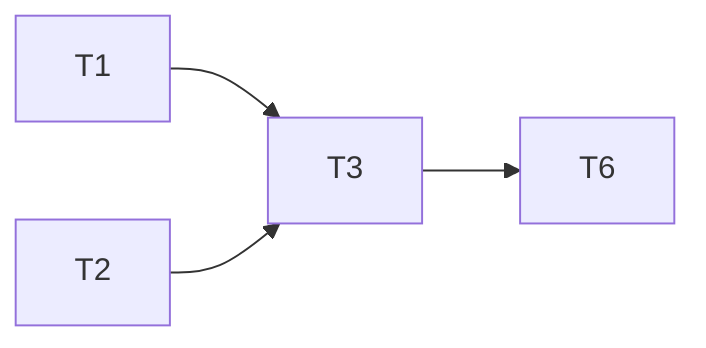

# Fixture plan

## 2. Architecture

## 9. Implementation plan

### T1 · parser · Complexity 3 · Est. context 20k · Est. time 1 min

**Owns:** `src/a.py`, `tests/test_a.py`
**Produces:** a.parse(text: str) -> list

### T2 · lexer · Complexity 3 · Est. context 20k · Est. time 3 min

**Owns:** `src/b.py`
**Produces:** b.lex(text: str) -> list

### T3 · evaluator · Complexity 4 · Est. context 30k · Est. time 2 min

**Owns:** `src/c.py`
**Consumes:** a.parse (T1), b.lex (T2)

### T4 · cli tools · Complexity 2 · Est. context 15k · Est. time 2 min

**Owns:** `pkg/{d,e}.py` (the cli), `docs/`

### T5 · server · Complexity 3 · Est. context 25k · Est. time 2.5 min

**Owns:** pkg/f.py

### T6 · wiring · Complexity 2 · Est. context 15k · Est. time 1 min

**Owns:** `src/main.py`

## 10. Review
Ruling: not a ledger line.
